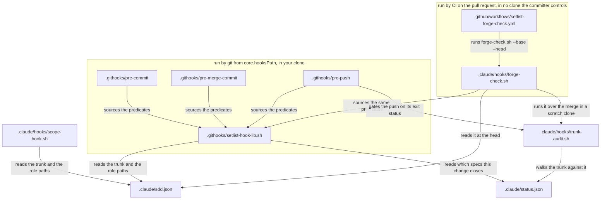

# Setlist

[](https://code.claude.com/docs/en/discover-plugins) [](https://github.com/AlexCiortan/setlist/blob/main/.claude-plugin/plugin.json) [](LICENSE) [](https://github.com/AlexCiortan/setlist/actions/workflows/test.yml)

Setlist is spec-driven development for Claude Code. You write the setlist, Claude Code plays it, and git hooks stamped into your repository refuse work that skipped the process. It is for one developer or a small team who would rather review than type. Its unit is the repository: a system of several repositories runs one instance in each, every one under its own hooks, and a change that spans them is a spec in each, citing the one system spec they share. Every feature arrives through a spec you approved, and the spec outlives the chat, a compacted context and a swapped model. Spec Kit and BMAD give the agent a process to follow. Setlist gives git a process to enforce, so it holds under any agent or none. It is a discipline control for cooperating use and no security boundary. [How Setlist thinks](HOW-SETLIST-THINKS.md) is the ten-minute account a lead can forward to a team.

## Quickstart

Setlist requires macOS, Linux, or Windows 11 with Git for Windows, and bash, git and `jq` on PATH (jq 1.7 or later on Windows). Without `jq` every governed commit is refused. It requires Claude Code 2.1.193 or later, for the marketplace rename and the `fallbackModel` chain. The deny mechanic is verified on 2.1.200 and later, the re-grounding pointer reaches a resumed or continued session whole from 2.1.277, the stamped deny and ask rules hold under sandbox auto-allow from 2.1.289, and from 2.1.295 the bypass deny blocks a command when it times out or cannot start. Install the plugin from inside Claude Code, then run session zero in your project on `opus`, or on the escalation tier of the model ladder for a complex project: `fable` in the edition's Part 2 table, or `best` without Fable access. Day-to-day building runs under `/model opusplan`. `/setlist:validate` re-runs the `opusplan` probe in both phases. It names a phase served by a model outside its tier, which a managed model allowlist changed after the stamp can cause, or by a model other than the one the stamp recorded. No plugin? Copy the edition's three files ([`setlist.md`](setlist.md), [`setlist-operations.md`](setlist-operations.md), [`setlist-changelog.md`](setlist-changelog.md)) into your project and ask a session on `opus` (or on the escalation tier for a complex project) to run its bootstrap, retrofit or upgrade protocol.

```
/plugin marketplace add AlexCiortan/setlist
/plugin install setlist@setlist
/model opus      # or: /model fable for a complex project
/setlist:new     # an existing repo: /setlist:retrofit; an older instance: /setlist:upgrade
```

Before you adopt Setlist, observe mode, `/setlist:retrofit --observe`, shows what it would do. It reads an existing repository's last 50 merges and prints every one the trunk audit would have refused, by commit and code, and it installs and writes nothing. On an instance, `/setlist:upgrade` prints the same reading as a verdict delta between the audit you have and the new one, both ways, before anything is replaced.


## What you get: the operating loop

`/setlist:new` is an architecture session you drive, and its first message says so. The session contract names what it decides only with your approval (the stack, the core data model, the scope and every default it writes down) and what it never decides for you (boundaries, data ownership, the repository split and anything with a cost); you can ask it anything at the level you work at. Its second question is the sizing question: one deployable, several with their own pipelines, or an existing estate, who else builds here, and what already exists. The answers pick one of three depth modes: ordinary for one deployable, deep for several, with one round per topic, and estate for a system that already runs as several repositories. A deep round ends when its decisions are written or you say enough, never when the session runs out of defaults. The deep rounds take one topic each: boundaries and ownership, contracts between components, data, pipelines and deployment, failure modes and the riskiest integration, and observability last, and every crossing gets a named contract or an open question. `/setlist:retrofit` starts with the estate inventory: it asks whether the repository is the whole system or one of several, reads each sibling you name without writing to it, shows each role path with its file count for you to confirm, and for an estate writes the system as it found it, every missing piece an open question. Every decision your idea leaves open is a question or a line in the assumption register: the default taken, why, and the question that would change it, which you keep, change or leave for later. A high-level idea gets its decisions first: when the session cannot name your deployables, users and core data, it derives the open decisions and asks them in order of consequence, three at a time, before proposing anything. It asks how your system splits into repositories, by pipeline, release cadence and team, and records the repository split with its reason. For a system of several repositories it writes the system spec first, `system.md` in a system repository with the contracts beside it, and each repository's first spec cites it in a `Cites:` line that `/setlist:validate` reads. Its bootstrap plan lists the repositories in order; the session stamps each one with the system spec's path recorded in `.claude/sdd.json`, reports a progress line per repository, and stops at the first failure. It stamps the hooks and an `AGENTS.md` pointer beside `CLAUDE.md` for other harnesses, and writes your first specs; `/scaffold` makes the first commit. The golden rules in your `CLAUDE.md` tell the model that types to finish the spec and nothing more, to claim a change done only after a real check ran, to give options when asked, and to hand mechanical runs to the delegated tier while planning and the close review stay on the stronger ones. Under Claude Code's `opusplan` setting the Planner decides in plan mode and the Builder types in execution mode. The model rule: the edition binds each tier by its alias, never by a version, and records what each alias served as a dated reading. Your part is approvals, answers to parked questions and QA Pass 2; you never type code or Git. Each feature runs one loop, with your stack's commands in the generated `RUNBOOK.md`:

1. **Plan.** Shift+Tab into plan mode. The Planner re-grounds from `STATUS.md`, asks the real forks and proposes the next spec. You approve, and the Builder writes it. The spec reader, a read-only agent on the delegated tier, then lists the questions a Builder would still ask, and every assumption the spec rests on that you have not approved (the readers read the register), and the Planner answers them in the spec.
2. **Branch.** `/setlist:checkpoint` makes the trunk claim first: the ACTIVE flip lands on the trunk and is pushed, after you approve the push, before the branch exists, so every clone that fetches sees the spec is taken. The claim pushed with it is the empty `spec/NNNN-<slug>` branch, in the same atomic push, and the re-grounding hook names the remote's other spec branches at every session start, from the last fetch and with its age (or that the age is unknown), making no network call. Then it opens `spec/NNNN-<slug>`, and it refuses to open a branch whose spec the trunk does not carry at ACTIVE; since 2.15.0 such a branch is also refused at push by `pre-push` (`SLH-CLAIM-NOT-ON-TRUNK`). After this and every other lifecycle flip it prints the visibility block: what landed on the trunk, what was pushed, who can see it now, and what is still only local.
3. **Build.** Small commits with the gates run. Ambiguities are parked in `STATUS.md` and never improvised. When the Builder loops on a bug, the `model-ladder` skill says when to escalate.
4. **QA Pass 1.** With gates green, the automated criterion check runs on the delegated tier and its report goes into the spec's Closing report. Delegated work runs through the Agent tool on `haiku` and never as a fork, which would run on your session's model; the journal line names the model that ran it. The edition's model table reads each alias per provider: on Claude Platform on AWS and the cloud-provider platforms `haiku` is a generation behind, and `/setlist:validate` names the Haiku generation that served it when it is not Haiku 5.
5. **QA Pass 2.** You use the feature and spot-check at least one passed criterion.
6. **Close.** `/setlist:checkpoint` runs the close review. A second model, on the Opus tier in a fresh context, reads the branch's diff against the spec's criteria and reports every finding with its file and line; a criterion that rests on an assumption you left for later is a MAJOR finding. Its block records each round's effort line, the level the review ran at. You fix what it finds and it reads again, two rounds at most; the call past them is yours. Then it runs the close checklist and merges `--no-ff`, and git refuses a close whose review did not pass. `STATUS.md` names the next action.
7. **Next.** Shift+Tab, repeat.

## How it holds

The guarantee lives in git hooks, which git runs from its own state after the shell is done. So it travels with the repository. A merge that brings feature code to the trunk without closing a spec or recording a chore is refused in your clone. The forge check asks the same questions on the pull request. Since 2.12.0 the audit's codes name every verdict it prints, and a git call the audit depends on that fails is refused by name, so an audit that read nothing never passes as clean. Since 2.13.0 the commit layer reads the same way: a commit-time hook whose git call fails refuses by name and never reads the failure as an empty answer. You adopt it in levels, in this order:

| Level | Who needs it | What it refuses |
|-------|--------------|-----------------|
| **The git hooks** (`pre-commit`, `pre-merge-commit`, `pre-push`) | Everyone, in every clone | A commit, a merge or a push whose history skipped a spec |
| **The forge check** | A team | The pull request's merge, where the trunk requires the check beside a review |
| **The session layer** | Optional | Nothing: it warns the agent, and its one deny nudges |
| **Custody** | Whoever approves specs | A build whose spec approval is missing or drifted (a key, or the forge's review) |

Since 2.14.0 the long commands, `/setlist:checkpoint`, `/setlist:upgrade` and `/setlist:validate`, keep each `SKILL.md` under 20,000 bytes and read their rarely needed sections from `references/` files beside it, so the steps a flip and a close depend on survive a long session's compaction. The upgrade to 2.14.0 names every edit an instance receives and migrates nothing in your own files: the new header lines and settings keys are read only where present. The upgrade to 2.15.0 delivers the changed hooks and the trunk audit and migrates nothing either. The plugin version it records is what puts the two push refusals in force, so a branch cut before the upgrade is not asked until it merges the trunk. Since 2.12.0 every instance carries a `verify` skill. Claude Code asks for a skill of that name before a commit, and this one runs your gate command and reports what it printed. It persuades the agent and refuses nothing, and the git hooks refuse whether or not it ran. Since 2.13.0 the bypass deny blocks a command when it times out or cannot start (Claude Code 2.1.295 and later), and the forge check reads no credential: the stamped workflow asks the forge and hands it the answers.



What the arrows assert: every refusal between unreviewed work and a shared trunk comes from `.githooks/pre-commit`, `.githooks/pre-merge-commit`, `.githooks/pre-push` through `.claude/hooks/trunk-audit.sh`, or `.claude/hooks/forge-check.sh`, and all four source one set of predicates in `.githooks/setlist-hook-lib.sh`. The scope hook's arrow is a read that ends in advice and never in a refusal. The trunk audit runs at every push and on every pull request. It reads history rather than commands, so it sees work that arrived through a renamed branch, a cherry-pick or the forge's merge button. It walks from the trunk audit's baseline, which `/setlist:upgrade` records in `.claude/sdd.json` where an instance's history predates its hooks. Refused merges complete the way the message says, at push as at commit. The armed check reports at session start when `core.hooksPath` or `merge.ff` is off, and the stamp refuses a bad answer by name. On a checked-out branch without `.claude/sdd.json`, `pre-commit` and `pre-merge-commit` exit in silence, and `pre-push` reads the pushed commits' own. A branch without `.githooks/` runs no hook. Another hook manager (husky, lefthook, pre-commit) is chained, its hook running beside Setlist's verdict. An octopus onto the trunk is refused by name. The hooks and the audit read history with replace refs ignored, so they judge the commits a push sends, and a failed read of HEAD is refused by name at commit and merge time (2.14.0). On a first push to an empty remote, `pre-push` audits the trunk the instance declares and names every other pushed branch it did not audit (2.14.0). A committer who crafts merges to evade the audit can, and those routes are the Known limitations. Does it work? Every release passes a dogfood gate: a fresh agent given only this repository takes a small application from an empty directory to a merged, twice-QA-passed feature. The suite behind the CI badge drives every hook through fixture repositories on Linux and macOS at every push, and its platform smoke on Windows.

## Commands and skills

| Command | What it does | Invoked by |
|---------|--------------|------------|
| `/setlist:new` | Bootstraps an empty directory: interview, decisions for your approval, the two-phase stamp. | You only |
| `/setlist:retrofit` | Inventories an existing codebase read-only, then fits the framework around what exists. | You only |
| `/setlist:upgrade` | Migrates an instance to the bundled edition on one docs-only chore branch, gates unchanged. | You only |
| `/setlist:gate` | Runs a roadmap stage-gate transition against the stage's exit criteria. | You only |
| `/setlist:checkpoint` | Spec-scoped Git: the branch, commits with secret and style checks, the close checklist, the `--no-ff` merge. | You, or the model when about to commit |
| `/setlist:validate` | Health-checks the instance and reports findings, fixing nothing without approval. | You, or the model at a transition gate |
| `/setlist:board` | Reads the trunk and the remote: every spec by state with its driver, branch and age, and the collisions it can see. Refuses nothing. | You, or the model before a flip |
| `/setlist:journal` | Writes the numbered journal entry for a substantive session. | You, or the model after a substantive session |

`/scaffold` is no plugin command: `/setlist:new` generates it as a project-local skill. It wires the test harness, makes the first commit and arms the git hooks by setting `core.hooksPath` and `merge.ff`. Five reference skills load by themselves when they apply:

| Skill | Loads when | Carries |
|-------|------------|---------|
| `model-ladder` | A session weighs escalating | The escalation rules between model tiers |
| `planner-discipline` | Planning starts | The operating loop, the read budget, park-do-not-improvise |
| `spec-authoring` | A spec is being written | The spec template and the Closing report contract |
| `design-surface` | UI work routes through a design intake | The intake on `/design`, locked redlines committed as spec contracts, design QA on the branch |
| `diagrams` | A diagram is drawn or synced | The routing test, the drawing rules, five type references |

For UI work the design surface is Claude Code's `/design`. A design intake drafts the screens as artboards on a **design canvas** on claude.ai, and you pick one per screen. The locked redline, the picked artboards' exports and every decision the canvas's comments record are committed under `docs/design/` before the spec that builds to it goes ACTIVE, and design QA reads that committed redline. `/design` needs an interactive session signed in with a claude.ai account and the Design template on; without it, a mock made another way is committed by the same rule.

## Teams and diagrams

Since 2.6.0 the discipline above holds across a team, and since 2.7.0 a diagram is a set of claims the close checks. Each item links its boundary. **The team round** in session zero and the retrofit asks who builds and how many at once, how the trunk is protected, who approves a spec and who may flip it ACTIVE, and how long a claim may stand untouched, and writes the answers into a Team section of `product.md`. **The Driver line** in a spec's header names who holds it: the checkpoint writes it at the ACTIVE flip from your declared identity or git's `user.email`, inside the hashed range, so anyone who reads the trunk sees who is building what. Since 2.15.0 the driver key carries the same handle in the status record, which the board reads first. With attestation off, the checkpoint's hash refresh after the `Owns:` lines it appends prints what moved, the hash before and after, and any other edit it refuses. **The forge check** runs as the status check `setlist forge check` on every pull request. It asks the merge the button would make what the git hooks ask, and names every pull-request edit to the enforcement paths. Require it on the trunk beside one approving review and code-owner review, which the check itself requires under `forge` custody. [Boundary](LIMITATIONS.md#forge-check-required). **`forge` custody** makes a spec's approval the ACTIVE flip landing on the protected trunk through the required review, with no signing key. [Boundary](LIMITATIONS.md#forge-check-required). **The CODEOWNERS bridge** makes `.githooks/`, `.claude/`, `specs/attest/` and `.github/` reviewed changes, and judges every spec's `Owns:` lines against the stamped file. [Boundary](LIMITATIONS.md#codeowners-bridge). **Parallel specs** run on two branches with disjoint `Owns:` sets and close in turn. Since 2.11.0 the audit refuses the second of two overlapping closes by name until its branch carries the first close's change. The overlap report comes earlier: at each `Owns:` line it appends, the checkpoint names every other ACTIVE spec on the trunk and every spec on a remote branch that declares the same file, with its driver, and refuses nothing. Since 2.15.0 the claims are refused at push: `pre-push` refuses a spec branch pushed before its ACTIVE flip is on the trunk, and a spec number the remote already holds under another slug. [Boundary](LIMITATIONS.md#declarations-claim). **The merge-edit report** (2.11.0, git 2.38 and later) names every file a two-parent merge changed outside its conflicts, for a reviewer; it never refuses. [Boundary](LIMITATIONS.md#crafted-merges). **Three gate tiers**, `gates.commit`, `gates.close` and `gates.push` in `.claude/sdd.json`, name what runs at each layer. [Boundary](LIMITATIONS.md#fast-forward). **The lite spec tier** keeps the parts the gates read and refuses a lite spec past five files as `SLH-LITE-OVERSIZED`. [Boundary](LIMITATIONS.md#declarations-claim). **The bypass deny**, the session layer's one refusal, stops a command that disarms the git hooks for its own run. Since 2.10.0 it reads heredocs and backslash continuations as a person writes them. [Boundary](LIMITATIONS.md#hard-deny-expansion). **The scope hook's** advice about a write on the trunk reaches the agent. Its path matching resolves a relative path, a symlinked leaf (up to sixteen links, saying when it stops) and a role spelled in another case. [Boundary](LIMITATIONS.md#advisory-persuades). **The Stop hook** refuses once to end a turn with a spec change unstaged, and the Stop hook's reasons lead with the fix. [Boundary](LIMITATIONS.md#stop-hook). **Secret files** are named in the stamped deny list (`.env`, `.env.local`, `.env.production` and their kin), for the Read tool and since 2.14.0 for `cat`, where a pattern used to hide `.env.example`, the example environment file a session keeps current.

For diagrams there are **three diagram altitudes** (context, containers, components). Each file under `docs/diagrams/` opens with a four-line header, and a close's diagram field must name the files the closing commit touched. [Boundary](LIMITATIONS.md#diagram-checks). **Node evidence**: a drawn path missing at the close is refused for the closing spec's own nodes, and inline edge labels are read as labels. [Boundary](LIMITATIONS.md#diagram-checks). **A generated view as a lockfile**, opt-in through `diagram_command`, must equal that command's output at every close. [Boundary](LIMITATIONS.md#diagram-checks). **Render validation** at the forge parses every Mermaid block under a pinned version and refuses one that does not parse. [Boundary](LIMITATIONS.md#diagram-checks). **The `diagrams` skill and the Design sketch** let a spec draw the intended change, which `/setlist:checkpoint` folds into the living diagrams at the close.

## Why one spec at a time

One spec is active at a time, and no two agents write coupled code at once. For a person who directs and does not type, the bottleneck is how much code can be reviewed before the next thing is built on it. Ten features in parallel are not ten times the progress if you can review two. Read-only work (sweeps, probes, verification runs) fans out freely. Across a team, two people can each run a spec on their own branch: the audit refuses overlapping closes as above, and the forge check judges every merge. What Setlist does not have, by design, is a coordination plane inside one checkout. What it has instead is the spec board: `/setlist:board` reads the trunk and the remote from any clone, with no server, and shows every claim, its driver and branch, and every collision it can see, such as one number claimed twice (the next number is taken from the trunk and the remote's spec branches, and when two cuts still collide the first trunk landing keeps it; since 2.15.0 the second is refused at push, `SLH-CLAIM-NUMBER-TAKEN`) or two ACTIVE specs declaring one file; it refuses nothing, and it cannot see a claim nobody pushed. The push race is the lock: when two people flip one spec, git refuses the second push, and the checkpoint fetches and reports who holds the spec. The board shows stale claims, ACTIVE specs whose branch has had no commit for `stale_days` (seven by default), with their drivers, and counts ACTIVE specs per driver without limiting them.

## Known limitations

The guarantee lives in the git hooks, and the session hooks carry no part of it; the push-time trunk audit stands between unreviewed work and a shared trunk. Read the list as a threat model. Each bullet is a fact about git, the forge or the harness that a hook cannot refuse, and each release's adversarial review tests those routes on the shipped bytes. Design boundaries are decisions with a date and a reason, open limitations are defects with a status, and upstream conditions are outside this project's control. Each group opens to a title and a short summary per bullet; [LIMITATIONS.md](LIMITATIONS.md) has the full text, what to do, and the history.

### Design boundaries (21)

<details><summary>Show the design boundaries</summary>

- **Git hooks are per-clone, and the tracked directory narrows that without closing it.** A fresh clone has the hooks but not the config that points at them. It is unprotected until `refresh-instance.sh --apply` runs, and the forge check is the layer that does not live in a clone.
- **`--no-verify` and `SETLIST_SKIP_HOOKS=1` skip the git hooks, the push-time audit included.** A deliberate flag with an obvious name, or Setlist's own escape variable, skips every git hook, the push-time audit and content scan included. Every git hook reads the variable first. `SETLIST_SKIP_TRUNK_AUDIT=1` is the narrow escape. No refusal names either, and the forge check has no such flag.
- **git allows one `core.hooksPath`, so Setlist runs another hook manager's hooks through its own rather than beside them.** The stamp and the refresh chain husky, lefthook or pre-commit and leave it in place. Each Setlist git hook runs that manager's hook of the same name beside its own verdict, before its checks where the index becomes the commit, and both refusals surface. A manager that re-points `core.hooksPath` on install switches Setlist off again, and the next session start reports it.
- **`git merge --ff-only`, `--ff` and `--squash`: a fast-forward fires no merge hook, and squash needs one flag under the stamped setting.** A fast-forward creates no merge commit, so no merge hook runs. The stamped `merge.ff=false` makes a plain `--squash` fail with a message that names neither Setlist nor the setting. The push-time audit still reads a one-commit close correctly, a squash included, and refuses a multi-commit fast-forward on its intermediate commits.
- **The trunk audit's frame is declared in `.claude/sdd.json`, the trunk by name and the baseline by commit, and a declaration is a claim under the same custody as the rest of `.claude/`.** Merge onto a branch with another name than the recorded trunk, and the whole layer stays silent. The audit walks history from `audit.baseline`, which the upgrade records where an instance's history predates its hooks. A key moved forward walks less, so review it as you review the hooks.
- **The push-time hooks read only the branch and tag namespaces, so a push to a review-ref namespace is ungoverned by them.** A push to Gerrit's `refs/for/<branch>` or any other namespace skips both the content scan and the trunk audit. Since 2.7.0 the hook reports the skip by name. The ways through are to push the trunk directly or to require the forge check.
- **The staged-content scans read every staged line unless you scope them.** The em-dash and secret scans read every added line of the index, vendored code and fixtures included, unless `scan_exclusions` in `.claude/sdd.json` names the paths. Every skip is printed with the glob that matched it.
- **Secret and style scanning is best-effort early warning, not a guarantee.** The scan reads a rendering the repository controls, with a first-cut pattern set, so it catches accidents on the ordinary path and nothing more. Since 2.11.0 a `.gitattributes` `-diff` or `binary` entry no longer hides a text file from it, except in a merge commit's own change at push.
- **A checkout decides which hooks exist: a branch that does not carry `.githooks/` runs no git hook, and commit and merge time read the checked-out `.claude/sdd.json`.** A branch that never carried Setlist has no `.githooks/`, so checking it out leaves git no hook to run, and a push refused from the trunk succeeds from it. `pre-push` reads a pushed commit's own `.claude/sdd.json` when the checkout has none. The forge check refuses a pull request whose head carries none.
- **The set of tested platforms is a list, not a proof.** The suite runs on Linux under two awks, on macOS under bash 3.2 with the BWK awk, and since 2.11.0 on Windows 11 under Git Bash. On Windows a hook call costs about three times a Mac's, and NTFS cannot hold some of the file names the suite exercises. The list is extended, and it is never restated as a proof.
- **The close review is a second model on your own account: it shares the builder's blind spots on taste, not on bytes, so its block is a verdict per criterion and never a grade.** It reads bytes against criteria in a fresh context, and its judgment is no different from the builder's. QA Pass 2 stays yours. So does the decision at its two-round cap, recorded as `ACCEPTED-BY-HUMAN` beside the reviewer's verdict.
- **A diagram check compares a claim to a diff and a lockfile to a command's output; it does not judge whether a drawing is true of the code.** The field checks establish that the files the closer named are the files the commit touched. The node check establishes that every drawn path exists, and the lockfile that the generated view equals the command's output. Only a path-shaped name (a slash, no whitespace) is checked, and the rest is printed as unverified. Three Mermaid shapes are unread by decision. The render check parses only where a renderer runs, and without one it fails the stamped workflow's job instead of passing.
- **The session layer persuades; its one deny is a nudge a crafted command passes.** The bypass deny stops an obvious spelling of disarming the git hooks for its own run, and ordinary variable expansion, a short list of spellings its frozen parser misreads, a persistent `core.hooksPath` change or a fresh clone (reported at the next session start as `[SR-HOOKS-NOT-ARMED]`), and a write or a git command through Bash or another interpreter all pass it. From Claude Code 2.1.295 it blocks a command when it times out or cannot start; a skipped scope or Stop hook is advice missed, and a hook whose matcher is not a valid pattern never runs. The git hooks and the trunk audit are the catch.
- **The forge check reads what the forge exposes: it governs the merge button only where the trunk requires it, reads the trunk's protection as it stands now, and runs the pull request's own copy of itself.** The stamped check is a report until the trunk lists `setlist forge check` as required beside a review and review from Code Owners, and it cannot require itself. A rebase-merge trunk defeats it before the fact. A trunk protected after an unreviewed flip landed verifies that flip. A pull request that edits the workflow or the hooks is judged by its own edit. So the check refuses a `forge`-custody trunk without "Require review from Code Owners", and it names every edit to the enforcement paths.
- **The CODEOWNERS bridge reads a subset of the file's grammar, and a pattern is a claim about paths.** `Owns:` declarations are judged against the core CODEOWNERS grammar. Sections, negations and character classes are refused by name, and GitHub evaluates no character class either. Only email owners resolve locally.
- **A declaration is a claim, not a verified fact: the single-parent close arm is as strong as your `Owns:` lines, and the integrity chain as strong as where your signing key lives.** A close is audited file by file against its own `Owns:` lines, which travel in the commit they justify, so the hooks verify coverage and never truth. A spec that declares nothing closes under the older whole-commit exemption. A signature proves a key was used, and never that a person decided. `forge` custody has no key and rests on the forge's required review instead.
- **The hashed range ends at the FIRST line reading `## Closing report`, fences included, and the ownership reader agrees with that cut.** A quoted copy of the template above your `Owns:` lines ends the signed range early, and the declaration below it is refused as out of range. The refusal names the one-edit fix.
- **A session killed from outside fires no Stop, and the Stop hook is a nudge, never a lock.** The Stop hook refuses once to end a turn with an unstaged spec or `specs/STATUS.md` change, in a project with its own repository. A session killed from outside fires nothing, and the git hooks are what refuse the work.
- **One repository is one instance: no gate reads across repositories, and a change that spans them is governed by each repository's own hooks and by a citation no hook verifies.** Each repository's hooks, audit and forge check read that repository alone, so a change across two is a spec in each, and whether the pair agrees is a reviewer's question.
- **Deliberate evasion: a committer who crafts history to pass the trunk audit can, and the list of known routes is maintained rather than complete.** A chained merge, and its octopus spelling into a spec branch, hide unspecced work behind a compliant close; an octopus onto the trunk is refused since 2.11.0. Five sideways commands (`git cherry-pick`, a detached-HEAD merge, `git rebase`, `git reset --hard`, the pathspec checkout) are refused at push, unless composed with a compliant close that declares no ownership. A merge that edits a file outside its conflicts is reported on git 2.38 and later and never refused, while an edit inside them reads as resolution. A local replace ref showed the audit a commit other than the one a push sends until 2.14.0, which closed that route.
- **The scope hook's warning reaches the agent, and the agent may proceed anyway: advisories persuade, hooks refuse.** Since 2.9.0 the scope hook's reason rides the field Claude Code delivers to the agent, and an agent may still judge the write harmless and proceed. The git hooks' refusals at commit, merge and push are what hold.

</details>

### Open limitations (0)

None stands at 2.15.0: the two that stood at 2.9.0 were fixed in 2.11.0. [Full text.](LIMITATIONS.md#open-limitations-0)

### Upstream conditions (0)

None stands at 2.15.0: the one that stood, a timed-out hook read as a skipped gate, left when the bypass deny began to block on failure; what still skips is in the session layer's bullet above. [Full text.](LIMITATIONS.md#upstream-conditions-0)

## Repository contents

| File | What it is |
|------|------------|
| [`setlist.md`](setlist.md), [`setlist-operations.md`](setlist-operations.md), [`setlist-changelog.md`](setlist-changelog.md) | The framework edition, the single source of truth, in three files: the core (Parts 1 to 6), the operating protocols and appendices (Parts 7 to 10 and Appendices A to C, the spec template among them), and the Changelog. The version is stated inside each file. |
| `.claude-plugin/`, `skills/`, `templates/`, `scripts/`, `test/`, `.github/` | The plugin, a binding of the edition, with the hook suite and the workflow that runs it on every push. |
| [`HOW-SETLIST-THINKS.md`](HOW-SETLIST-THINKS.md), [`LIMITATIONS.md`](LIMITATIONS.md) | The ten-minute account a lead forwards to a team, and every boundary in full. |

## Versions

The current edition of the framework document is **[setlist.md](setlist.md)** with its two companion files, [setlist-operations.md](setlist-operations.md) and [setlist-changelog.md](setlist-changelog.md) (edition v1.23, the claims edition; the version lives inside each file). You do not need to read it to start; Part 1 in `setlist.md` and Part 10 in `setlist-operations.md` are the short way in. The edition version counts the protocol and moves when the document changes what a gate asks or what a close writes. The plugin version counts the binding (`.claude-plugin/plugin.json`, 2.15.0) and moves on every release of the tooling, edition turn or not. The plugin counter restarted at 1.0.0 when the plugin was renamed to `setlist`. So the releases 1.6.0 through 1.8.0 that the edition's changelog names belong to the pre-rename plugin, and a Setlist version below them is not a downgrade.

Without the plugin, the edition is three Markdown files read in order: `setlist.md` (the core, Parts 1 to 6), `setlist-operations.md` (Parts 7 to 10 and the appendices, the spec template among them) and `setlist-changelog.md` (what each edition changed).

## Contributing

[Open an issue](https://github.com/AlexCiortan/setlist/issues) with what held and what fought you; the form "A refusal I did not expect" is for a refusal. [CONTRIBUTING.md](CONTRIBUTING.md) says how changes land, and [SECURITY.md](SECURITY.md) how to report a security problem. **What the package carries:** at hook time the plugin fetches nothing and runs only the commands your `.claude/sdd.json` declares. The stamped workflow installs `jq` and a pinned Mermaid parser. The forge check reads no credential and makes no network call: the stamped workflow asks the forge through the forge's own action, with the workflow's own token, and hands the check the answers as a file. The tokens and secrets the test suite uses are fixtures, joined from parts when the suite runs: strings the scans must refuse, so the suite can show they do, and no shipped file carries one whole. The recording at the top of this page is a real session captured on screen, kept outside the package; the package's one image is its icon.

## About the author

Built by [Mihai Alexandru (Alex) Ciortan](https://www.linkedin.com/in/alexciortan), Principal Architect with 15+ years of enterprise platform engineering at one of the world's largest game publishers and part-time CTO at DEIO. The framework is distilled from running real projects with Claude Code end to end, and this repository is maintained under the discipline it describes.

## License

© 2026 Alex Ciortan. The code (`scripts/`, `templates/`, `test/`, `skills/` and `.github/`) is released under the [Apache License, Version 2.0](LICENSE), and each stamped hook and script says so in an SPDX line at its top. The framework document, [setlist.md](setlist.md) with [setlist-operations.md](setlist-operations.md) and [setlist-changelog.md](setlist-changelog.md), and the prose beside it are released under the [Creative Commons Attribution 4.0 International License](LICENSE) (CC BY 4.0): use, adapt, and share it, including commercially, as long as you give appropriate credit. Suggested attribution: "Setlist, a spec-driven development framework by Alex Ciortan, licensed under CC BY 4.0." Both texts are in [LICENSE](LICENSE).
